# 🌐 NetWatch Pro 3.0

> **Production-Ready Visual Terminal Network Monitor & All-in-One Diagnostics Hub**  
> *Zero external dependencies. Pure modern C++17. Native on macOS, Linux, and Windows.*

```
╭─────────────────────────────────────────────────────────────────────────────╮
│ ◉ NETWATCH PRO 3.0  │  1 Overview   2 Compare   3 Detail   4 Outages   5 Toolbox   6 Help   │
│ Running 00:14:28 · Every 3s · Pings: 289 · Hosts: 3 · Alerts ON             │
╰─────────────────────────────────────────────────────────────────────────────╯
╭─ ▶ Cloudflare DNS (1.1.1.1) ──────────  ▂▃▄▅▆▇█  ✔ EXCELLENT ~12 hops ─╮
│ RTT: 11.4ms   Avg: 11.8ms   Min: 10.9ms   Max: 14.2ms   P95: 12.5ms   Jitter: 0.4ms   Loss: 0.0%
│    15 │              ▅                     ▆                          │
│     0 │ ▂ ▂ ▂ ▂ ▂ ▂ ▂█ ▂ ▂ ▂ ▂ ▂ ▂ ▂ ▂ ▂ ▂ █ ▂ ▂ ▂ ▂ ▂ ▂ ▂ ▂ ▂ ▂ ▂ ▂   │
╰─────────────────────────────────────────────────────────────────────────╯
╭─ ▶ Default Gateway (192.168.1.1) ─────  ▂▂▂▂▂▂▂  ✔ EXCELLENT ~Direct ──╮
│ RTT: 1.2ms    Avg: 1.4ms    Min: 0.9ms    Max: 2.5ms    P95: 1.8ms    Jitter: 0.1ms   Loss: 0.0%
│     3 │                                                               │
│     0 │ ▂ ▂ ▂ ▂ ▂ ▂ ▂ ▂ ▂ ▂ ▂ ▂ ▂ ▂ ▂ ▂ ▂ ▂ ▂ ▂ ▂ ▂ ▂ ▂ ▂ ▂ ▂ ▂ ▂ ▂   │
╰─────────────────────────────────────────────────────────────────────────╯
```

---

## 🚀 Overview

**NetWatch Pro** is a high-performance terminal network command center built from the ground up in modern C++17. It brings together the functionality of everyday command-line tools—`ping`, `traceroute`, `tracert`, `mtr`, `dig`, `nslookup`, `nc`, `nmap`, `curl`, `wget`, `ifconfig`, `ip`, `ipconfig`, `route`, `ss`, `netstat`, and `tcpdump`—into a unified, flicker-free terminal interface.

By default, NetWatch launches directly into a **multi-target visual ping monitor** displaying real-time latency graphs, jitter, packet loss strips, and outage tracking. When deeper troubleshooting is required, pressing `5` or `t` opens the **Network Toolbox**, allowing you to execute diagnostics against any monitored target or custom IP with formatted visual tables and metric breakdowns.

---

## ✨ Features

### 📊 1. Real-Time Visual Latency & Availability Engine
- **Parallel ICMP Probing**: Concurrent multi-threaded ICMP echo engine (no `sudo` required on macOS or modern Linux).
- **8-Level Block Histogram**: Smooth Unicode bar charts (` `, `▂`, `▃`, `▄`, `▅`, `▆`, `▇`, `█`) showing latency trends.
- **Header Mini-Sparklines**: Fast visual glance for each host directly on its card header.
- **Comparative Multi-Host Graph**: Overlaid scatter/timeline plot with distinct markers (`●`, `◆`, `■`, `▲`, `★`, `✚`) and linear/logarithmic scale toggle (`l`).
- **Packet Loss Tape**: Color-coded loss visualizer pinpointing exactly when packet drops occurred.
- **16-Metric Deep-Dive Inspector**:
  - Current RTT, Minimum, Average, Maximum
  - Percentiles: 50th (Median), 95th (P95), 99th (P99)
  - Moving Jitter Average & Standard Deviation
  - Total Sent / Received / Packet Loss %
  - Recent (Last 60 pings) Packet Loss %
  - Success / Failure Streaks
  - Total Outages Count & Total Cumulative Downtime
  - Estimated Router Hops (from TTL) & DNS Resolution Latency
- **Latency Distribution Histogram**: 11-bucket frequency graph (<5ms to 500ms+) with percentage breakdowns.
- **Outage & Incident Journal**: Automatic detection of downtimes (2+ consecutive lost probes), recording timestamps, durations, reasons, and recovery times.

---

### 🧰 2. Integrated Network Toolbox (9 Essential Tools in One Place)

Access the Toolbox at any time by pressing `5` or `t`. Use `Tab` to select any monitored host, or press `c` to enter a custom domain/IP. All tools run asynchronously in background threads without blocking the UI.

| # | Tool | CLI Equivalents | What NetWatch Provides Beyond Default Tools |
|---|---|---|---|
| **1** | **Visual Traceroute** | `traceroute`, `tracert`, `mtr` | Clean tabular hop-by-hop breakdown with IP, Min/Avg/Max RTT, Loss %, latency sparkline bars, and hop tags (`[Gateway]`, `[Destination]`, `[Timeout]`). |
| **2** | **DNS Records Explorer** | `dig`, `nslookup` | Queries A, AAAA, MX, TXT, NS, SOA in parallel. Displays resolver IP, query latency, TTL, and color-coded record badges (`[ A ]`, `[AAAA]`, `[ MX ]`). Fallback to `nslookup` and native `getaddrinfo`. |
| **3** | **Port Scanner & Services** | `nc`, `nmap` | High-speed multi-threaded TCP connect scan across top 25 service ports (Web, SSH, Mail, DB, RDP, DNS, Redis, Mongo). Displays open status badges (`[ OPEN ]`), latency, and service names in < 300ms. Zero dependencies. |
| **4** | **HTTP / Web Inspector** | `curl`, `wget` | Visual latency waterfall: `DNS Lookup` ➔ `TCP Connect` ➔ `TLS Handshake` ➔ `TTFB` ➔ `Total Time`. Status pills (`[ 200 OK ]`, `[ 301 MOVED ]`) and parsed response headers. |
| **5** | **Network Interfaces** | `ifconfig`, `ip`, `ipconfig` | Auto-enumerates local adapters via native `getifaddrs`: Interface name, Status (`[ UP ]`), IPv4, Netmask, Broadcast, and hardware MAC address (`14:98:77:81:d1:f5`). |
| **6** | **Routing Table & Gateway** | `route`, `ip route`, `netstat -r` | Discovers default gateway with automatic health check, plus destination subnets, gateway hops, interfaces, and flags. |
| **7** | **Active Sockets & Ports** | `ss`, `netstat`, `lsof` | Filters active TCP listening ports and established connections with local/foreign endpoints and connection states (`LISTEN`, `ESTABLISHED`). |
| **8** | **Traffic & Packet Stats** | `tcpdump`, `netstat -i` | Displays interface packet throughput counters (Rx/Tx packets, bytes in MB/GB, interface collisions, and packet errors). |
| **9** | **Custom Command Runner** | Custom terminal CLI | Run any native command with custom flags (e.g. `nmap -sV target`) with live streaming into the interactive scrollable viewer. |

---

### 🎨 3. Terminal User Experience
- **Interactive Modals**:
  - `a`: Add new target host or IP dynamically without restarting.
  - `d`: Delete selected target host.
  - `+` / `-`: Change ping interval on the fly (1s to 60s).
  - `c`: Specify custom target IP for diagnostics.
  - `/`: Search and highlight within diagnostic tool outputs.
  - `s`: Export report or current view to a timestamped file.
- **Dual Mode**: Toggle between **Rich Structured Visuals** and **Raw Terminal Output** (`v`).
- **Smooth Navigation**: Scroll through long tool outputs with `↑`, `↓`, `PageUp`, and `PageDown`.
- **Double-Buffered Rendering**: Entire screen is composed in memory and flushed via a single atomic `write()`, completely eliminating terminal flicker.
- **Responsive Layout**: Adapts automatically to terminal window resizing (`SIGWINCH` / `TIOCGWINSZ`).

---

## ⌨️ Keyboard Shortcuts Reference

| Key | Context | Action |
|---|---|---|
| `1` – `4` | Monitor | Switch Views: `1` Overview, `2` Multi-Chart, `3` Detail, `4` Outages |
| `5` or `t` | Any | Open **Network Toolbox** (toggles back to Dashboard if already in Toolbox) |
| `6` or `?` | Any | Open **Help & Keybindings** guide |
| `1` – `9` | In Toolbox | Launch tool: 1 Traceroute, 2 DNS, 3 PortScan, 4 HTTP, 5 Interfaces, 6 Routes, 7 Sockets, 8 Traffic, 9 Custom |
| `Tab` / `←` / `→` | Any | Cycle through monitored targets |
| `a` / `A` | Monitor | **Add Target Host** (opens interactive text prompt) |
| `d` / `D` | Monitor | **Remove Target Host** from monitoring list |
| `r` / `R` | Monitor / Tool | Trigger immediate ping probe / Re-run active diagnostic tool |
| `p` / `P` | Monitor | Pause / Resume automated ping probes |
| `+` / `-` | Monitor | Increase / Decrease ping interval |
| `l` / `L` | View 2 | Toggle logarithmic vs linear latency scale |
| `v` / `V` | In Toolbox | Toggle between **Parsed Visual Table** and **Raw Terminal Output** |
| `c` / `C` | In Toolbox | Specify custom target host/domain/IP for diagnostics |
| `/` | In Toolbox | Search and highlight text in tool output |
| `s` / `S` | Any | Save / Export current view or tool report to a file |
| `z` / `Z` | Monitor | Reset all statistical counters and outage logs |
| `Esc` / `b` | Toolbox / Help | Return to Overview Dashboard |
| `q` / `Q` | Any | Cleanly exit NetWatch and restore terminal |

---

## 🛠️ Compilation & Installation Guide

NetWatch Pro has **zero external library dependencies** (no ncurses, no libcurl, no boost). All you need is a C++17 compiler.

### 🍎 1. macOS (Clang / Apple Silicon & Intel)

#### Quick Build (Single Command):
```bash
clang++ -std=c++17 -O2 -Wall -Wextra -pedantic netwatch.cpp -o netwatch -pthread
```

#### Using Make:
```bash
make
sudo make install    # Installs to /usr/local/bin/netwatch
```

#### Running:
```bash
./netwatch                      # Default targets + auto-detected router gateway
./netwatch 1.1.1.1 8.8.8.8      # Monitor specific targets
./netwatch -i 2 -g github.com   # 2-second interval, include router gateway
```

---

### 🐧 2. Linux (Ubuntu, Debian, Fedora, Arch, CentOS)

#### Install Prerequisites:
- **Debian / Ubuntu**:
  ```bash
  sudo apt update && sudo apt install build-essential
  ```
- **Fedora / RHEL**:
  ```bash
  sudo dnf install gcc-c++ make
  ```
- **Arch Linux**:
  ```bash
  sudo pacman -S base-devel
  ```

#### Compile:
```bash
g++ -std=c++17 -O2 -Wall -Wextra -pedantic netwatch.cpp -o netwatch -pthread
```

#### ICMP Socket Permissions on Linux:
Modern Linux distributions allow unprivileged ICMP datagram sockets out of the box (`net.ipv4.ping_group_range`). If your distribution has restricted unprivileged ICMP, you can enable it system-wide with:
```bash
sudo sysctl -w net.ipv4.ping_group_range="0 2147483647"
```
Or allow NetWatch to use raw sockets with Linux capabilities:
```bash
sudo setcap cap_net_raw+ep ./netwatch
```

---

### 🪟 3. Windows (MSYS2 MinGW-w64 or Visual Studio MSVC)

#### Option A: MSYS2 / MinGW-w64 (Recommended)
Open the MSYS2 UCRT64 or MinGW64 terminal:
```bash
g++ -std=c++17 -O2 netwatch.cpp -o netwatch.exe -lws2_32 -liphlpapi
```

#### Option B: Visual Studio (Developer Command Prompt / MSVC)
Open **Developer Command Prompt for Visual Studio**:
```cmd
cl /std:c++17 /O2 /EHsc netwatch.cpp ws2_32.lib iphlpapi.lib /Fe:netwatch.exe
```

#### Option C: CMake (Cross-Platform)
```bash
mkdir build && cd build
cmake ..
cmake --build . --config Release
```

---

## 📖 CLI Usage & Command-Line Flags

```
Usage: netwatch [options] [host ...]

Options:
  -i <sec>      Interval between ping rounds in seconds (default: 3)
  -t <sec>      Reply timeout in seconds (default: 2)
  -l <file>     Export continuous ping stream to CSV log file
  -a            Enable audio bell and OS notifications on host outage
  -g            Automatically detect and monitor default router/gateway
  -h, --help    Display usage instructions and exit
```

### Examples:

1. **Launch default monitor (Cloudflare, Google, and your local Gateway)**:
   ```bash
   ./netwatch
   ```

2. **Monitor high-priority servers every 1 second**:
   ```bash
   ./netwatch -i 1 1.1.1.1 8.8.8.8 9.9.9.9
   ```

3. **Log pings to CSV for long-term telemetry analysis**:
   ```bash
   ./netwatch -l ping_history.csv google.com cloudflare.com
   ```

4. **Enable desktop notifications and alert bell when an outage occurs**:
   ```bash
   ./netwatch -a 192.168.1.1 mycompany.internal
   ```

---

## 🏗️ Architecture & Implementation Details

```mermaid
flowchart TD
    subgraph UI ["Terminal Presentation (ANSI Double-Buffer)"]
        V1["View 1: Overview Dashboard\n(Cards, Histograms, Sparklines)"]
        V2["View 2: Multi-Host Compare\n(Scatter Plots, Loss Tape)"]
        V3["View 3: Deep-Dive Inspector\n(16 Metrics, Buckets, Jitter)"]
        V4["View 4: Outages Journal\n(Downtime & Incident Log)"]
        V5["View 5: Network Toolbox\n(9 Diagnostics Tools Hub)"]
        V6["View 6: Keybindings & Help"]
    end

    subgraph Core ["Engine & State Controller"]
        Loop["Non-Blocking Event Loop\n(100ms Select / Poll)"]
        SiteState["Target State & Statistics\n(Histograms, Moving Jitter, Outages)"]
        Modals["Dynamic Modal Manager\n(Add/Delete Host, Interval, Search)"]
    end

    subgraph Network ["Zero-Dependency Diagnostic Drivers"]
        ICMP["Multi-Threaded ICMP Echo Engine\n(POSIX SOCK_DGRAM / Windows Ping)"]
        Trace["Traceroute / MTR Driver\n(Hop-by-hop latency sparkline)"]
        DNS["3-Tier DNS Resolver\n(dig ➔ nslookup ➔ getaddrinfo)"]
        PortScan["Parallel TCP Port Scanner\n(Non-blocking connect & banner grab)"]
        HTTP["HTTP / Web Latency Inspector\n(DNS + Connect + TLS + TTFB)"]
        IF["Hardware Interface Inspector\n(getifaddrs + MAC hardware addresses)"]
        Route["Routing Table Inspector\n(Kernel routing & Gateway discovery)"]
        Sock["Socket Inspector\n(ss / netstat listening ports)"]
        Traffic["Traffic & Bandwidth Stats\n(Byte transfer counters & packets)"]
    end

    Loop --> SiteState
    Loop --> Modals
    Loop --> UI
    SiteState --> ICMP
    V5 --> Trace
    V5 --> DNS
    V5 --> PortScan
    V5 --> HTTP
    V5 --> IF
    V5 --> Route
    V5 --> Sock
    V5 --> Traffic
```



---

## 📄 License

MIT License. Free and open source for personal, commercial, and enterprise use.
